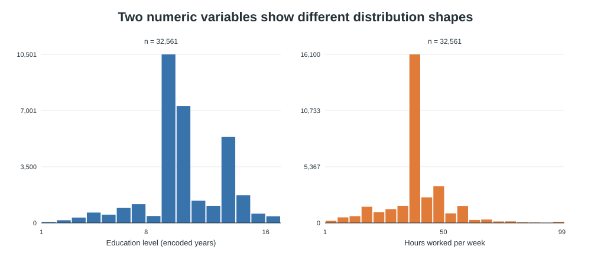
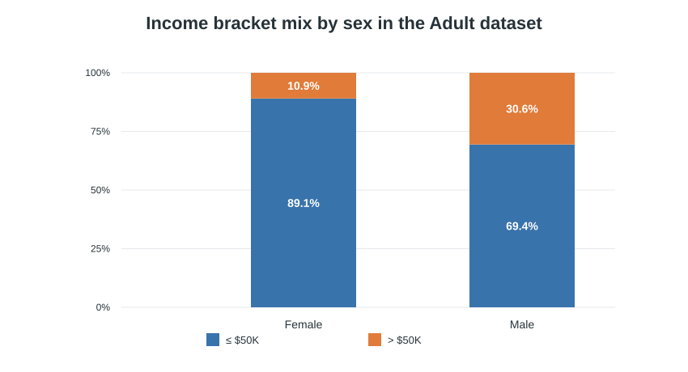
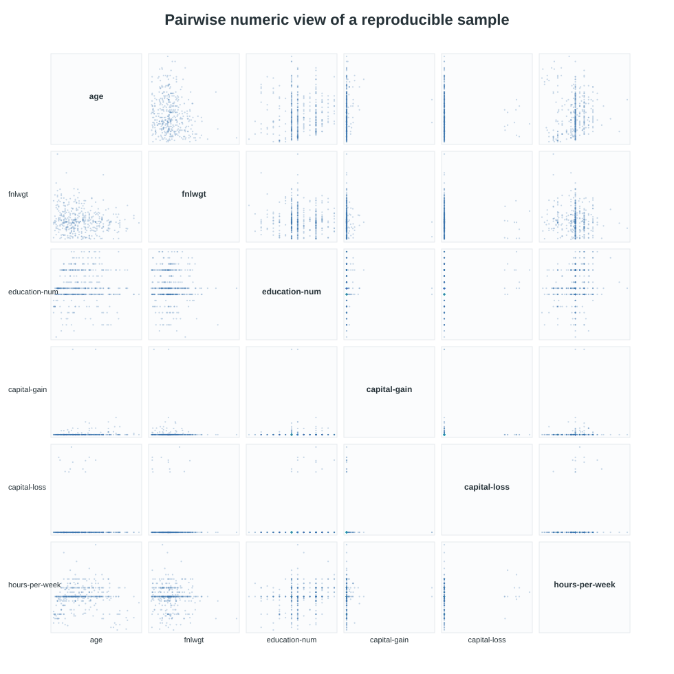
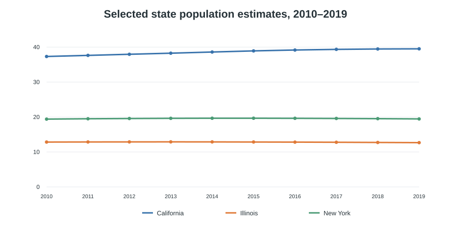

# Exploratory Data Analysis with R: Census Income and Population

An exploratory analysis of two public datasets using R. The project examines numeric and categorical distributions in the Adult income dataset, then combines annual population estimates to compare population trends across selected states.

## Questions explored

- How are education level and weekly work hours distributed in the Adult dataset?
- How does the recorded income bracket mix vary by sex in this dataset?
- How did population estimates change in California, Illinois, and New York from 2010 to 2019?
- What data cleaning steps are needed to combine alternating-year files and handle a missing estimate?

## Findings

- The Adult dataset contains **32,561 records**. The median encoded education level is 10, and the median reported work week is 40 hours.
- In this dataset, 30.6% of male records and 10.9% of female records are in the `>50K` income bracket. This is a descriptive comparison, not evidence that sex causes an income difference; the data are historical and do not control for other factors.
- From 2010 to 2019, the provided population estimates show California growing by about 5.9%, Illinois declining by about 1.3%, and New York growing by about 0.3%.
- The population files cover the 50 states, Washington, D.C., and Puerto Rico. Adding their 2019 values together is a combined geography total, not the U.S. population. Adding a state's annual population across ten years produces person-years, not a single population count.

## Visuals

### Numeric distributions



### Income bracket by sex



### Numeric relationships



### Selected state population trends



## Methods

The analysis uses summary statistics, histograms, counts, a proportional stacked bar chart, a scatterplot matrix, a join, missing-value handling, row-wise summaries, and a long-format transformation for line-charting.

The Wisconsin 2019 value is missing from the supplied odd-year file. The analysis fills it with the U.S. Census Bureau Vintage 2020 estimate of 5,822,434 rather than carrying the 2018 value forward. Internal missing years are interpolated from adjacent years. These choices are documented in the code because imputation affects the resulting trend and summaries.

## Reproduce

1. Install R and the `tidyverse` package.
2. From this repository's root folder, run:

   ```sh
   Rscript analysis.R
   ```

The script reads the CSV files in `data/` and writes reproducible SVG charts to `images/`. The repository also includes preview charts rendered from the same source data.

## Repository contents

```text
.
├── analysis.R
├── data/
│   ├── adult.csv
│   ├── population_even.csv
│   └── population_odd.csv
└── images/
    ├── adult-distributions.svg
    ├── income-by-sex.svg
    ├── numeric-pairs.svg
    └── state-population-trends.svg
```

## Data sources

- **Adult dataset:** [UCI Machine Learning Repository — Adult](https://archive.ics.uci.edu/dataset/2/adult), licensed under [CC BY 4.0](https://creativecommons.org/licenses/by/4.0/).
- **Population estimates:** [U.S. Census Bureau, State Population Totals: 2010–2020 (Vintage 2020)](https://www.census.gov/programs-surveys/popest/technical-documentation/research/evaluation-estimates/2020-evaluation-estimates/2010s-state-total.html). The included files are the alternating-year extracts used for this analysis.

## Limitations

These are descriptive explorations of historical datasets. The Adult data reflect a particular dataset version and period, while the population figures are estimates from Vintage 2020. The charts describe patterns in these data and should not be treated as causal findings or current population estimates.
